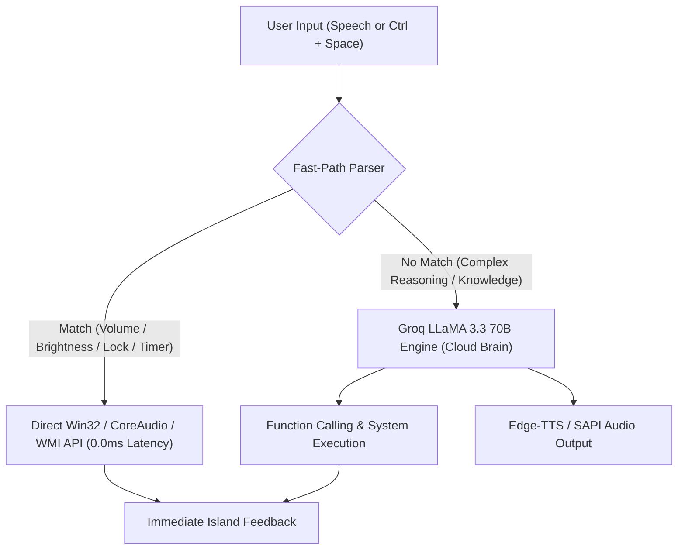

# Zenith OS

<div align="center">


### **Precision at your screen’s edge. Intelligent. Weightless. Pitch Black.**

[](https://microsoft.com)
[](https://python.org)
[](https://riverbankcomputing.com)
[](https://groq.com)
[](https://android.com)
[](LICENSE)

**Zenith OS** is a hyper-minimalist, high-performance AI desktop companion and dynamic island interface designed for Windows, created by **Mr. Vansh Soni**.

[Download Setup Installer](#-download--setup) • [Key Features](#-key-features) • [Robot Eyes](#-autonomous-expressive-robot-eyes) • [AI Routing](#-apex-ai-companion--fast-path-engine) • [Architecture](#-architecture--tech-stack) • [Developer Guide](#-developer-quickstart)

</div>

---

## 🌟 Overview

Zenith OS transforms the unused upper edge of your Windows screen into a fluid, responsive OLED dynamic island (`#000000`). It unites:
- **Autonomous Expressive Robot Eyes**: A living 60 FPS vector companion with 16 distinct moods, gaze tracking, and real-time audio reactivity.
- **Groq LLaMA 3.3 70B Intelligence**: An ultra-low-latency voice/text AI assistant paired with a **0.0ms deterministic fast-path router** for instant hardware control.
- **Android 16 Waveform Seek Bar**: A 48-segment expressive audio visualizer with ambient radial album art glow and live SMTC media integration.
- **Smart Workspaces Engine**: One-click snapshotting and restoration of multi-window development and design desktop layouts.
- **Productivity & Telemetry**: Pomodoro focus timer, 10-item low-latency clipboard vault, anti-snapback capsule volume/brightness controls, and live CPU/RAM/Battery metrics.

---

## 📦 Download & Setup

### 1. Windows Standalone Setup Wizard (Recommended)
You can install Zenith OS with a single double-click using the compiled Inno Setup package:

- **Installer Path**: `dist_setup/Zenith_OS_Setup.exe` (or on your Desktop: `Zenith_OS_Setup.exe`)
- **Package Size**: ~60.9 MB
- **Included**:
  - Full self-contained Python runtime and bundled dependencies (PyQt6, Groq, WinRT, PyAudio, Edge-TTS).
  - Desktop shortcut and Start Menu folder.
  - Optional Windows startup integration.
  - Silent setup support: `Zenith_OS_Setup.exe /VERYSILENT /SUPPRESSMSGBOXES /NORESTART`

### 2. Run Directly from Source (Developers)
```bash
# Clone the repository
git clone https://github.com/vanshsoni/DynamicIslandOS.git
cd DynamicIslandOS

# Install dependencies
pip install -r requirements.txt

# Launch Zenith OS
python main.py
```
*Or double-click `Launch_Island.bat` for one-click launch with automated dependency checking.*

---

## 🤖 Autonomous Expressive Robot Eyes

Zenith OS features a living vector robot companion rendered in pure procedural math at 60 FPS. It rests peacefully at **0.00% CPU overhead** via an event-driven LERP physics engine that sleeps when idle.

```
       [  ●  ]               [  ●  ]
      Left Eye              Right Eye
  (Cyan Glow #00F0FF)   (Autonomous Gaze)
```

### Supported Mood Matrix (16 Procedural Expressions)
| Mood State | Visual Expression | Trigger Condition |
| :--- | :--- | :--- |
| **Neutral Idle** | Dual rounded rectangular vector eyes with soft cyan bloom (`#00F0FF`) | Default standing-by state; glances naturally |
| **Happy Arch** | Upward smiling crescent arches (`^ ^`) | Positive AI feedback, successful task completion |
| **Love Hearts** | Neon pink pulsing hearts (`#FF5096`) with cubic bezier curves | Compliments, favorite user preferences |
| **Star Sparkle** | 8-point rotating golden stars (`#FFD700`) | Milestones reached, high focus achievements |
| **Wink** | Left eye open / right eye playful horizontal wink | Friendly gestures, greetings |
| **Command Mic** | 3 vertical equalizer lines driven by real-time microphone input | Active user speech detection (`Ctrl + Space`) |
| **AI Responding** | Rhythmic undulating harmonic sine waves | Groq LLaMA 3.3 text-to-speech playback |
| **Curious Squint** | Subtle eye narrowing with upward tilt | Incoming system notification |
| **Dizzy / Confused** | Asymmetrical eye heights with quizzical tilt | Unrecognized prompt or ambiguous syntax |
| **Focused Scanner** | Ultra-sleek horizontal laser slits with sweeping beam | Pomodoro active focus session |
| **Shocked Surprise**| Wide vertically dilated ovals | Critical battery warning, unexpected volume spike |
| **Dead Offline** | Red crossed `X  X` dead eyes (`#FF2233`) | Automatic watchdog detects lost internet access |

---

## 🧠 Apex AI Companion & Fast-Path Engine

Zenith OS pairs the reasoning depth of **Groq LLaMA 3.3 70B Versatile** with a **deterministic local fast-path engine** that executes system commands with zero network latency.



### Fast-Path Hardware Commands (0.0ms Latency)
| Voice / Text Command | Target Subsystem | Underlying Windows API |
| :--- | :--- | :--- |
| `"volume up"` / `"volume down"` | Master Audio | Windows CoreAudio / `WinMM.dll` endpoint |
| `"mute"` / `"unmute"` | Audio Endpoint | CoreAudio Endpoint Mute |
| `"brightness up"` / `"brightness down"` | Display Luminance | `WmiMonitorBrightnessMethods` |
| `"lock the pc"` / `"lock windows"` | Session Security | `User32.LockWorkStation()` |
| `"set timer for 25 minutes"` | Productivity Timer | Internal Pomodoro QTimer Countdown |
| `"launch Development workspace"` | Workspaces Engine | ShellExecuteEx + DWM Window Snapping |
| `"what are my current system stats"` | Telemetry Cache | `psutil` CPU / RAM / Battery / Uptime |

---

## 🎵 Android 16 Expressive Waveform Seek Bar

The built-in media tab connects directly to Windows Global System Media Transport Controls (WinRT GSMTC):

- **48 Organic Waveform Bars**: Dynamically calculated vertical bars replace legacy slider thumbs.
- **Live Seeking**: Click or drag across the waveform to jump directly to any track timestamp.
- **Ambient Radial Art Glow**: Extracts the dominant vibrant tone from live album artwork and projects a soft radial blur behind the island.
- **Wall-Clock Resumption**: Resuming from idle accurately calculates track progression even if the island was closed during playback.
- **Audio Output Switcher**: Instant dropdown to switch between headphones, speakers, or external monitors.

---

## ⚡ Smart Workspaces Orchestration

Stop hunting for open windows and re-arranging your displays. Zenith OS snapshots and orchestrates complete multi-app workflows:

1. **Window Enumeration**: Queries the Desktop Window Manager (DWM) for all visible, non-minimized user applications.
2. **App Resolution**: Maps running process IDs to executable paths or Universal Windows Platform (UWP) Application User Model IDs (AUMID).
3. **Layout Restoration**: Launches all missing processes and snaps their windows to their exact captured multi-monitor coordinates.
4. **Preconfigured Layouts**:
   - **Development**: VS Code, Windows Terminal, Microsoft Edge.
   - **Design Studio**: Figma, Spotify, Slack / Discord.
   - **Custom Workspaces**: Capture any active setup in 1 click from the Workspaces tab.

---

## ⏱️ Focus & Break Timer (Pomodoro)

- **Two Native Modes**: **Focus** (25 minutes, cyan indicator) and **Break** (5 minutes, emerald green indicator).
- **Steppers**: `+5m` and `-5m` quick adjustment pills.
- **Minimalist Hover Bar**: When the timer is active, hovering over the compact island reveals streamlined controls:
  - `⏸` / `▶` Pause / Resume
  - `⏹` Reset
  - `›` Switch Mode (Focus ⇋ Break)

---

## 📋 Low-Latency Clipboard Hub

- Automatically records up to **10 recent text items**.
- **Instant Restore**: Click any clipped entry to immediately restore it to the active Windows clipboard.
- **Clean OLED Design**: Truncates long code snippets and URLs with clean line heights and one-click clear.

---

## 📊 Real-Time Hardware Telemetry

- **System Metrics**: Real-time readouts for CPU load, RAM allocation, Battery state (charging / percentage), and system uptime.
- **Anti-Snapback Capsule Sliders**: Volume and Brightness vertical sliders feature an active user-drag lockout to prevent telemetry polling from snapping the slider thumb during adjustments.

---

## ⌨️ Global Shortcuts

| Shortcut | Action |
| :--- | :--- |
| `Ctrl + Space` | Trigger Zenith AI Companion (Voice listening & text prompt) |
| `Click Top Notch` | Expand / Collapse Zenith OS glass dashboard |
| `Hover Top Notch` | Reveal quick media & timer hover controls |
| `Escape` | Instantly close expanded dashboard to compact island |

---

## 🛠️ Architecture & Tech Stack

```text
DynamicIslandOS/
├── main.py                 # Core entrypoint, state machine, frameless overlay & hotkey engine
├── dashboard_widget.py     # Multi-tab OLED glass dashboard (Music, Timer, System, Workspaces, Clipboard)
├── island_eyes.py          # Procedural 60 FPS vector eyes, reactive mic waves & idle state
├── ai_worker.py            # Groq LLaMA 3.3 router, Whisper STT, Edge-TTS audio DSP & memory store
├── workspace_engine.py     # Win32/DWM window capture, Store AUMID resolver & workspace launcher
├── system_tools.py         # Hardware telemetry, audio, display brightness & system tools
├── media_worker.py         # Windows Runtime (WinRT) Global System Media Transport Controls
├── settings_dialog.py      # Frameless Apple-styled settings & workspace manager
├── config.py               # Persistent JSON configuration manager
├── manual_test_suite.py    # Automated subsystem tests & AI command test harness
├── MANUAL_TESTING_GUIDE.md # Step-by-step human testing & verification guide
├── Launch_Island.bat       # One-click developer launcher with auto-pip install
├── Launch_Standard.vbs     # Silent background launcher
├── requirements.txt        # Python package dependencies
├── website/                # Zenith OS modern product website
│   ├── index.html          # Semantic HTML5 with ReactBits SideRays WebGL2 background
│   ├── styles.css          # Apple OLED `#000000` styling & responsive layout
│   └── script.js           # WebGL2 volumetric light, 16-mood vector eyes & offline AI playground
└── packaging/              # Release packaging scripts
    ├── build_all.py        # PyInstaller + Inno Setup automated build orchestrator
    ├── installer.iss       # Inno Setup 6 installer script
    └── zenith_icon.ico     # High-resolution application icon
```

---

## 🌐 Product Website Showcase

The project includes a product website located in [`website/`](website/index.html):

- **ReactBits WebGL2 SideRays Background**: GPU-accelerated volumetric light shafts and interactive floating dust motes with cursor tracking.
- **Interactive Robot Eyes Bento Card**: Test all 16 robot expressions, cursor gaze tracking, and click blinks directly in the browser.
- **Dual-Core AI Architecture Showcase**: Comprehensive breakdown of the Groq LLaMA 3.3 70B cloud brain, sub-millisecond fast-path router, and Whisper STT.
- **Dedicated Windows Setup Guide**: Visual 4-step installation walkthrough for `Zenith_OS_Setup.exe`.
- **Mobile & Android Responsive Navigation**: 3-line hamburger menu with slide-out sidebar drawer for direct section traversal on mobile screens.

To view the website locally:
```powershell
Start-Process "website/index.html"
```

---

## 👤 Author & Credits

**Zenith OS** is designed and created by **Mr. Vansh Soni**.

- **Creator**: Mr. Vansh Soni
- **Email**: `vanshsoni665566@gmail.com`
- **LinkedIn**: [linkedin.com/in/vanshsoni1](https://www.linkedin.com/in/vanshsoni1/)
- **GitHub**: [github.com/sonivansh1](https://github.com/sonivansh1)
- **Location**: Bhopal, India
- **License**: [MIT License](LICENSE)

*Crafted with precision for Windows.*
